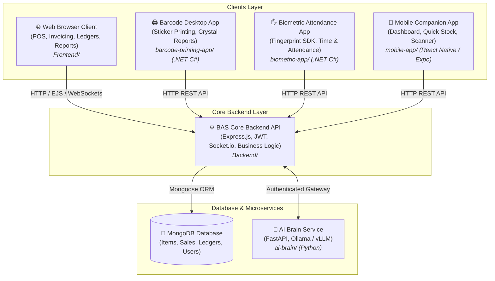
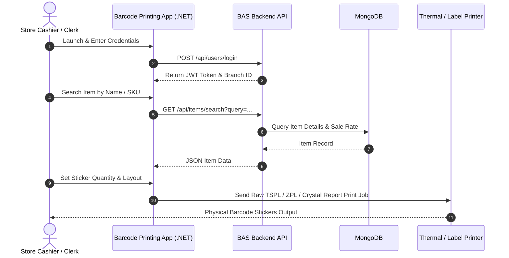
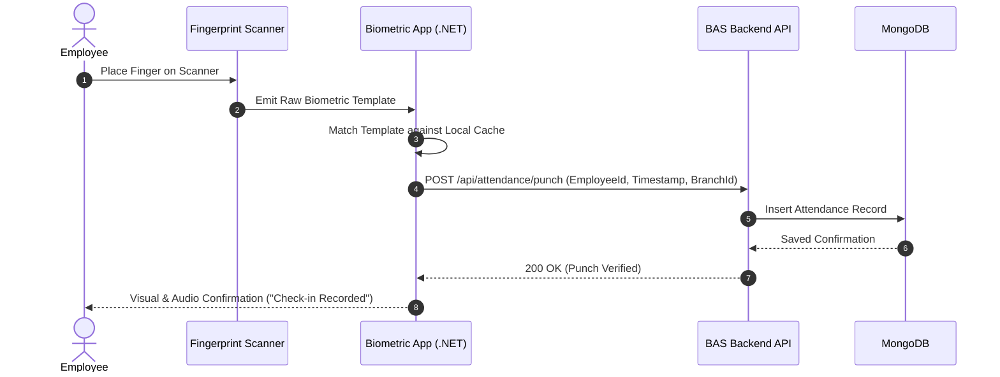
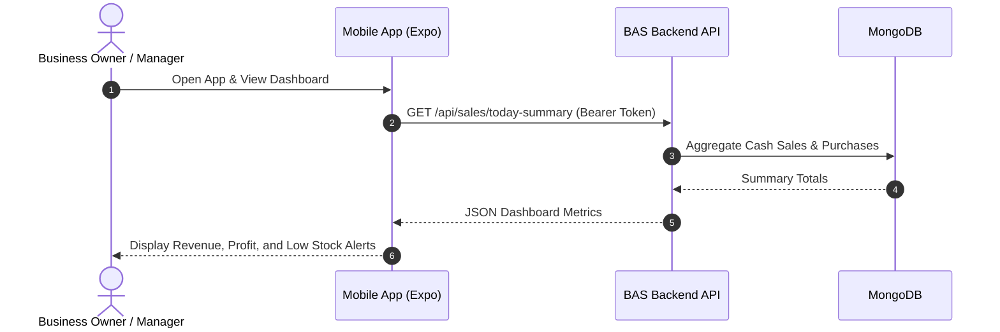

# 🏗️ Bilal Accounting System (BAS) - Project Structure & Architecture

Welcome to the **Bilal Accounting System (BAS)** codebase map. This repository contains the complete ecosystem of software supporting pharmacy, retail, inventory, POS, accounting, barcode generation, biometric employee attendance, and mobile management.

**Core Development Team**:
- **Mr. Wasi** (`@wasidevxyz-pixel`) - Lead Backend Engineer & Systems Architect
- **Bilal Shah** (`@bilalshah`) - Lead Frontend Engineer & UI/UX Architect

---

## 🧭 High-Level Architecture



---

## 📦 Directory Structure & Component Matrix

```
BAS-SOFTWARE/
│
├── 📁 Backend/                   # Core Web Server & REST API
│   ├── config/                   # MongoDB connection & AI catalog configurations
│   ├── controllers/              # REST API controllers (Sales, Items, Accounts, Users)
│   ├── middleware/               # Auth, role check, branch isolation, error handling
│   ├── models/                   # Mongoose Schemas (Item, Purchase, CashSale, Ledger, etc.)
│   ├── routes/                   # HTTP routing definitions (API & Web views)
│   ├── services/                 # Business logic (Double-entry accounting, banking, inventory)
│   ├── utils/                    # Common helper utilities
│   ├── server.js                 # Express application entry point
│   └── package.json              # Backend npm dependencies
│
├── 📁 Frontend/                  # Web ERP User Interface
│   ├── public/                   # Client-side static assets
│   │   ├── css/                  # Desktop-style UI stylesheets and print formats
│   │   ├── js/                   # Vanilla JavaScript view controllers (pos.js, items.js)
│   │   └── images/               # Logos and icons
│   └── views/                    # EJS & HTML page templates (POS, Reports, Ledgers, Inventory)
│
├── 📁 barcode-printing-app/      # .NET C# Desktop Barcode Printing Software
│   ├── BarcodePrintingApp.csproj # .NET project file
│   ├── Program.cs                # Entry point
│   ├── LoginForm.cs              # Authentication form (calls BAS Backend)
│   ├── MainForm.cs               # Barcode designer & printer controller
│   ├── SearchForm.cs             # Fast item search popup
│   ├── Models.cs                 # C# data transfer models
│   ├── Config.cs                 # API host & printer configuration
│   ├── BarcodeReport.rpt         # Crystal Reports barcode sticker layout
│   └── appsettings.json          # App configuration
│
├── 📁 biometric-app/             # .NET C# Desktop Fingerprint & Attendance Software
│   ├── BiometricApp.csproj       # .NET project file
│   ├── Lib/                      # ⚠️ Fingerprint SDK & DigitalPersona DLLs (Must be preserved)
│   ├── Program.cs                # Hardware initialization & entry point
│   ├── Form1.cs / MainForm.cs    # Real-time attendance logging UI
│   ├── EnrollmentForm.cs         # Biometric fingerprint enrollment screen
│   ├── LoginForm.cs              # Admin authentication screen
│   ├── Models.cs                 # Employee & attendance models
│   ├── Config.cs                 # API endpoints & branch settings
│   └── appsettings.json          # App configuration
│
├── 📁 mobile-app/                # React Native / Expo Cross-Platform Mobile Application
│   ├── src/
│   │   ├── api/                  # Axios HTTP client for BAS Backend
│   │   ├── components/           # Reusable UI components
│   │   ├── navigation/           # Tab & Stack navigators
│   │   ├── screens/              # Dashboard, Stock, Camera Scanner, Sales screens
│   │   └── utils/                # Mobile helper functions
│   ├── App.js                    # Mobile application root
│   ├── app.json                  # Expo app configuration
│   ├── eas.json                  # EAS build profiles
│   └── package.json              # Mobile npm dependencies
│
├── 📁 ai-brain/                  # Isolated Python FastAPI AI Assistant
│   ├── app/                      # FastAPI application & LLM reasoning engine
│   ├── requirements.txt          # Python dependencies
│   └── README.md                 # Setup & configuration guide
│
├── 📁 scripts/                   # System Maintenance & Database Migration Tools
│   ├── audit-permissions.js      # User role & permission verification
│   ├── fix-permissions.js        # Permission repair script
│   └── check_stock.js            # Stock discrepancy validation
│
├── 📄 AGENTS.md                  # 🤖 Master instruction manual for AI agents
├── 📄 PROJECT_STRUCTURE.md       # 🗺️ System architectural reference (THIS FILE)
├── 📄 README.md                  # Human developer overview & quick start
└── 📄 .gitignore                 # Monorepo-wide Git exclusion rules
```

---

## 🔄 Core Workflows & Data Flows

### 1. Barcode Sticker Printing Workflow


### 2. Biometric Attendance Logging Workflow


### 3. Mobile Companion Workflow


---

## ⚙️ Environment Configuration Quick Reference

| Application | Configuration Location | Key Settings |
| :--- | :--- | :--- |
| **Backend** | `Backend/.env` | `PORT=5000`, `MONGODB_URI=...`, `JWT_SECRET=...`, `AI_BRAIN_URL=http://127.0.0.1:8001` |
| **Barcode App** | `barcode-printing-app/appsettings.json` | `ApiBaseUrl`, `DefaultPrinter`, `LabelWidth`, `LabelHeight` |
| **Biometric App**| `biometric-app/appsettings.json` | `ApiBaseUrl`, `BranchId`, `DeviceType`, `AutoSyncInterval` |
| **Mobile App** | `mobile-app/src/api/config.js` | `API_BASE_URL` (development/production endpoint) |
| **AI Brain** | `ai-brain/.env` | `MODEL_PROVIDER=ollama`, `LOCAL_MODEL=qwen2.5:7b-instruct`, `AI_BRAIN_SHARED_SECRET=...` |

---

## 🔒 Security & Git Policies

- **No Secrets in Repo**: Keep `.env` and `appsettings.json` local. Use `.env.example` templates.
- **No Compiled Binaries**: All `.exe`, `.dll` (except vendor SDKs in `biometric-app/Lib/`), `.pdb`, `.apk`, and build outputs are excluded via `.gitignore`.
- **No Build Logs**: Error logs (`*build_error*.txt`), compile logs, and terminal redirects are excluded.
